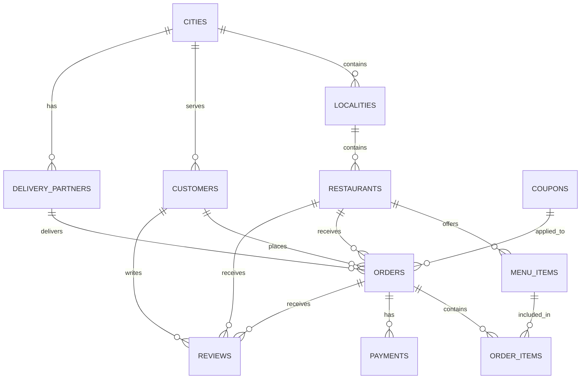

# Zomato Food Delivery Database — Schema Design

## 1. Introduction

This document describes the relational database schema designed for the Zomato Food Delivery project.

The schema was reconstructed using the 11 CSV seed data files provided with the project. The database is implemented in PostgreSQL under the `zomato` schema.

The database contains 11 tables and successfully loads all provided seed data.

## 2. Data Dictionary

### 2.1 cities

| Column | Data Type | Constraint | Purpose |
|---|---|---|---|
| city_id | INTEGER | PRIMARY KEY | Unique city identifier |
| city_name | VARCHAR(100) | — | Name of the city |
| state | VARCHAR(100) | — | State name |

### 2.2 localities

| Column | Data Type | Constraint | Purpose |
|---|---|---|---|
| locality_id | INTEGER | PRIMARY KEY | Unique locality identifier |
| city_id | INTEGER | FOREIGN KEY | References cities |
| locality_name | VARCHAR(150) | — | Name of locality |
| pincode | VARCHAR(10) | — | Postal code |

### 2.3 customers

| Column | Data Type | Constraint | Purpose |
|---|---|---|---|
| customer_id | INTEGER | PRIMARY KEY | Unique customer identifier |
| full_name | VARCHAR(150) | — | Customer name |
| email | VARCHAR(255) | — | Customer email |
| phone | VARCHAR(20) | — | Contact number |
| city_id | INTEGER | FOREIGN KEY | References cities |
| signup_date | DATE | — | Registration date |
| is_gold_member | BOOLEAN | — | Gold membership status |
| gold_expires_on | DATE | — | Membership expiry |
| is_active | BOOLEAN | — | Account status |

### 2.4 restaurants

| Column | Data Type | Constraint | Purpose |
|---|---|---|---|
| restaurant_id | INTEGER | PRIMARY KEY | Unique restaurant identifier |
| name | VARCHAR(200) | — | Restaurant name |
| locality_id | INTEGER | FOREIGN KEY | References localities |
| cuisines | TEXT | — | Cuisine information |
| avg_cost_for_two | NUMERIC(10,2) | — | Average cost |
| rating | NUMERIC(3,1) | — | Restaurant rating |
| rating_count | INTEGER | — | Number of ratings |
| opens_at | TIME | — | Opening time |
| closes_at | TIME | — | Closing time |
| is_pure_veg | BOOLEAN | — | Pure vegetarian status |
| status | VARCHAR(50) | — | Restaurant status |
| onboarded_on | DATE | — | Onboarding date |

### 2.5 menu_items

| Column | Data Type | Constraint | Purpose |
|---|---|---|---|
| item_id | INTEGER | PRIMARY KEY | Unique dish identifier |
| restaurant_id | INTEGER | FOREIGN KEY | References restaurants |
| item_name | VARCHAR(200) | — | Dish name |
| category | VARCHAR(100) | — | Dish category |
| price | NUMERIC(10,2) | — | Dish price |
| is_veg | BOOLEAN | — | Vegetarian status |
| is_bestseller | BOOLEAN | — | Bestseller indicator |
| is_available | BOOLEAN | — | Availability status |

### 2.6 delivery_partners

| Column | Data Type | Constraint | Purpose |
|---|---|---|---|
| partner_id | INTEGER | PRIMARY KEY | Unique partner identifier |
| full_name | VARCHAR(150) | — | Partner name |
| phone | VARCHAR(20) | — | Contact number |
| city_id | INTEGER | FOREIGN KEY | References cities |
| vehicle_type | VARCHAR(50) | — | Vehicle used |
| joined_on | DATE | — | Joining date |
| rating | NUMERIC(3,1) | — | Partner rating |
| status | VARCHAR(50) | — | Partner status |

### 2.7 coupons

| Column | Data Type | Constraint | Purpose |
|---|---|---|---|
| coupon_code | VARCHAR(50) | PRIMARY KEY | Unique coupon code |
| discount_pct | NUMERIC(5,2) | — | Discount percentage |
| max_discount | NUMERIC(10,2) | — | Maximum discount |
| min_order_value | NUMERIC(10,2) | — | Minimum order value |
| valid_from | DATE | — | Start of validity |
| valid_to | DATE | — | End of validity |

### 2.8 orders

| Column | Data Type | Constraint | Purpose |
|---|---|---|---|
| order_id | INTEGER | PRIMARY KEY | Unique order identifier |
| customer_id | INTEGER | FOREIGN KEY | References customers |
| restaurant_id | INTEGER | FOREIGN KEY | References restaurants |
| partner_id | INTEGER | FOREIGN KEY | References delivery partners |
| coupon_code | VARCHAR(50) | FOREIGN KEY | References coupons |
| placed_at | TIMESTAMPTZ | — | Order placement timestamp |
| accepted_at | TIMESTAMPTZ | — | Acceptance timestamp |
| picked_up_at | TIMESTAMPTZ | — | Pickup timestamp |
| delivered_at | TIMESTAMPTZ | — | Delivery timestamp |
| distance_km | NUMERIC(10,2) | — | Delivery distance |
| item_total | NUMERIC(12,2) | — | Total item cost |
| delivery_fee | NUMERIC(10,2) | — | Delivery fee |
| discount | NUMERIC(10,2) | — | Discount amount |
| total_amount | NUMERIC(12,2) | — | Final order amount |
| status | VARCHAR(50) | — | Order status |

### 2.9 order_items

| Column | Data Type | Constraint | Purpose |
|---|---|---|---|
| order_id | INTEGER | FOREIGN KEY | References orders |
| item_id | INTEGER | FOREIGN KEY | References menu_items |
| quantity | INTEGER | — | Quantity ordered |
| unit_price | NUMERIC(10,2) | — | Price per item |

### 2.10 payments

| Column | Data Type | Constraint | Purpose |
|---|---|---|---|
| payment_id | INTEGER | PRIMARY KEY | Unique payment identifier |
| order_id | INTEGER | FOREIGN KEY | References orders |
| amount | NUMERIC(12,2) | — | Payment amount |
| method | VARCHAR(50) | — | Payment method |
| payment_status | VARCHAR(50) | — | Payment status |
| attempted_at | TIMESTAMPTZ | — | Payment attempt timestamp |

### 2.11 reviews

| Column | Data Type | Constraint | Purpose |
|---|---|---|---|
| review_id | INTEGER | PRIMARY KEY | Unique review identifier |
| order_id | INTEGER | FOREIGN KEY | References orders |
| customer_id | INTEGER | FOREIGN KEY | References customers |
| restaurant_id | INTEGER | FOREIGN KEY | References restaurants |
| food_rating | INTEGER | — | Food rating |
| delivery_rating | INTEGER | — | Delivery rating |
| review_text | TEXT | — | Written feedback |
| created_at | TIMESTAMPTZ | — | Review timestamp |

## 3. Entity Relationship Diagram

## 4. Functional Dependencies

The following primary-key functional dependencies are identified:

- cities: city_id → city_name, state
- localities: locality_id → city_id, locality_name, pincode
- customers: customer_id → all customer attributes
- restaurants: restaurant_id → all restaurant attributes
- menu_items: item_id → all menu item attributes
- delivery_partners: partner_id → all partner attributes
- coupons: coupon_code → all coupon attributes
- orders: order_id → all order attributes
- payments: payment_id → all payment attributes
- reviews: review_id → all review attributes

For order_items, the combination of order_id and item_id can serve as a candidate key if each dish occurs only once per order. This assumption should be verified against the seed data.

## 5. Normalization

The schema is designed with relational normalization principles.

- First Normal Form (1NF): Attributes are represented as individual values rather than repeating groups.
- Second Normal Form (2NF): Tables with single-column primary keys have no partial dependency on a composite key.
- Third Normal Form (3NF): Descriptive attributes are separated into related entities to reduce unnecessary duplication.

The `cuisines` attribute in restaurants is stored as TEXT. Its atomicity and normalization should be reviewed based on the actual data representation.

## 6. Data Loading and Verification

All 11 CSV files were successfully loaded into PostgreSQL.

| Table | Expected Rows | Loaded Rows |
|---|---:|---:|
| cities | 10 | 10 |
| localities | 100 | 100 |
| customers | 25,000 | 25,000 |
| restaurants | 2,500 | 2,500 |
| menu_items | 50,000 | 50,000 |
| delivery_partners | 2,000 | 2,000 |
| coupons | 30 | 30 |
| orders | 150,000 | 150,000 |
| order_items | 375,000 | 375,000 |
| payments | 137,378 | 137,378 |
| reviews | 39,186 | 39,186 |

All loaded row counts match the expected seed data counts.

## 7. Integrity Check Results

### Check 1: Order items belong to the same restaurant as the order

Result: 0 violations.

All checked order items belong to the restaurant associated with their respective orders.

### Check 2: Delivered orders have exactly one successful payment

Result: 1,304 violations.

The investigation identified 1,304 delivered orders with no successful payment record. No multiple-successful-payment cases were found in the investigated group.

This is documented as a data anomaly requiring further investigation. The underlying data was not modified.

### Check 3: Pure vegetarian restaurants do not offer non-vegetarian dishes

Result: 0 violations.

No non-vegetarian menu items were found in pure vegetarian restaurants.

## 8. Conclusion

The Zomato Food Delivery database schema was reconstructed from the provided seed data and implemented in PostgreSQL.

All 11 tables were created and all seed data was loaded successfully. The row counts match the expected values. Two integrity checks passed with zero violations, while one identified 1,304 delivered orders without successful payment records.

The identified data anomaly is documented for further investigation.
